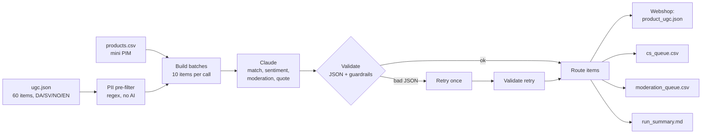

# UGC → Product Page Pipeline

Retailers collect lots of user-generated content (reviews, social captions, Q&A), but most of it never reaches the product page in a useful form. This n8n workflow takes raw UGC, works out which product each piece is about, judges sentiment and quality, flags what needs moderation or customer-service follow-up, and outputs the best quotes per product, ready for the webshop.

All data is invented: the shop "Hverdagsbutikken", its brands, products, customers, emails and phone numbers.

## How it works



Routing (the first rule that matches wins):

| # | Rule | Route | Goes to |
|---|---|---|---|
| 1 | `moderation = reject` | rejected | moderation queue |
| 2 | `needs_customer_service = true` | customer_service | CS queue |
| 3 | `moderation = review` (PII, selling, unclear) | review | moderation queue |
| 4 | no SKU, or `match_confidence < 0.6` | needs_human_match | moderation queue |
| 5 | everything else | approved | webshop (`product_ugc.json`) |

## Design choices

- **Rules first, AI second.** Regex catches emails and phone numbers before anything is sent to Claude. It's cheap and predictable, and an item flagged by the regex can never be auto-approved. Claude handles what regex can't see, such as a street address (`ugc_045`).
- **Batching.** 10 items per call means 6 calls for 60 items instead of 60. That's lower cost and latency, and the catalogue is only sent 6 times.
- **Strict JSON, treated as untrusted.** The validator parses the reply, checks every field and value, and retries failed items once with a note about what went wrong. Anything still broken goes to the moderation queue as `error`, so the run never stops halfway.
- **Never invent.** A SKU that isn't in the catalogue is removed in code, whatever the model says. A null match is better than a wrong product on a product page.
- **Quotes are excerpts, not rewrites.** The validator checks that every quote appears word for word in the original text. A rewritten or translated quote is dropped, so customer reviews are never altered.
- **Human in the loop.** Low confidence, PII and complaints go to people, not to the webshop.
- **Prompt injection.** The UGC is treated as data, and the system prompt tells Claude not to follow instructions inside it.
- **Low randomness.** The 5.5 models don't accept a custom `temperature` (the API returns a 400). Consistency comes from a tight prompt, calibrated confidence bands, `effort: low` and the deterministic validator.

## The nodes

| Node | What it does |
|---|---|
| Run pipeline | Manual trigger for the demo. Swap it for a Schedule or Webhook trigger to run it for real. |
| Settings | Every setting in one place: data URL, model, batch size, confidence threshold. No secrets. |
| Get products.csv / Get ugc.json | Fetch the two input files as text over HTTP. This works on n8n Cloud and self-hosted. |
| PII pre-filter | Parses the UGC and sets `pii_detected` from email and phone regex. |
| Build Claude batches | Parses the CSV and builds a compact catalogue (sku, name, variant, keywords). Splits the UGC into batches of 10 and builds one Messages API request per batch. The system prompt lives here. |
| Claude: match & moderate | HTTP POST to the Anthropic Messages API, once per batch. It retries 3 times on HTTP errors and continues on failure, so one bad call doesn't kill the run. |
| Validate Claude output | Parses, checks and applies guardrails, then collects the failed items for a retry. |
| Anything to retry? | IF node. Only calls Claude again when something failed. |
| Claude: retry / Validate retry | One extra call for the failed items, then the same validation. Anything still failing becomes `error`. |
| Route items | The routing rules above. Sets `route` (why) and `queue` (where). |
| Send to queue | Switch node with three outputs: Webshop, Customer service and Moderation. |
| Aggregate per SKU | Count, average rating, sentiment split, top topics and the top 3 quotes. Quotes are ranked by `quote_score`, with a +0.1 bonus for items with media. |
| Format CS rows / Format moderation rows | Choose the columns each team needs. |
| product_ugc.json, cs_queue.csv, moderation_queue.csv, run_summary.md, ugc_results.json | Convert to File nodes. Download the files from the execution view. `ugc_results.json` holds every item with its Claude output and route, which is handy for debugging and for the checker script. |

## Setup (about 15 minutes)

1. **Host the data.** Push this repo to GitHub as a public repo (no keys in it). The raw URL of the data folder looks like `https://raw.githubusercontent.com/<you>/ugc-pipeline/main/data`. A public Gist also works.
2. **Import the workflow.** In n8n, go to Workflows → Import from file → `n8n/workflow.json`.
3. **Add the API key as a credential.** Open *Claude: match & moderate* and go to Credential → Create new → **Header Auth**. Set Name to `x-api-key` and Value to your Anthropic API key, and save it as "Anthropic API key". Select the same credential in *Claude: retry*.
4. **Edit Settings.** Paste your `data_base_url`.
5. **Run.** Click *Execute workflow*. 60 items take about 1–3 minutes and cost well under $1 on Sonnet 5.5.
6. **Check the run.** Download `ugc_results.json` and `product_ugc.json` into a folder, then run `python3 tools/check_run.py <folder>`. It checks the definition of done (all items processed, PII caught, complaints in the CS queue, no invented SKUs, quotes are real excerpts) and lists judgement calls worth a look.

Self-hosted alternative: replace the two HTTP nodes with *Read/Write Files from Disk* plus *Extract from File*, or keep HTTP and serve `data/` locally.

## Testing without an API key

`tools/mock_server.js` fakes both the file hosting and the Messages API. It also misbehaves on purpose: it wraps one reply in code fences, cuts another off mid-JSON, invents a SKU and rewrites a quote. This exercises every validator path.

```bash
node tools/mock_server.js 8787
# in Settings: data_base_url = http://localhost:8787/data, anthropic_url = http://localhost:8787/v1/messages
```

The workflow has been run end to end against this mock in n8n 1.123: 60/60 items, retry path triggered, all guardrails fired, and `check_run.py` passes. `test/mock_output/` shows what that run produced. **Those outputs come from the mock, not from Claude.** Use a real run for the video.

## Repo layout

```
data/            products.csv, ugc.json, ugc_expected.json (ground truth for the checker)
n8n/workflow.json   the importable workflow (generated)
n8n/code/        source of every Code node
prompts/         the system prompt
tools/           gen_data.py, build_workflow.py, mock_server.js, check_run.py
```

To change a Code node or the prompt, edit the file and run `python3 tools/build_workflow.py`, or edit the node directly in n8n and re-export.

## Limitations

- Text only. Images and videos aren't checked.
- The catalogue is sent in every call. That's fine for 28 products, but thousands of SKUs need retrieval first (keyword or embedding search for candidates, then Claude picks).
- Confidence scores are the model's own estimate. They should be calibrated against human decisions.
- The files stand in for real systems. Nothing is written back to a webshop.

## Next steps

- Connect to the real UGC platform and PIM via API, run on a schedule, and push approved quotes to product pages.
- Human approval step for the moderation queue (Slack, or a small review UI) that feeds decisions back.
- Write quotes and topics back to the PIM as structured attributes (e.g. "good for sensitive skin").
- Weekly complaint digest per product for buying and quality teams.
- Image and video UGC: check that the product is visible, plus basic safety checks.
- Measure: share of products with UGC on the page, moderation time saved, and conversion on pages with vs. without quotes.
